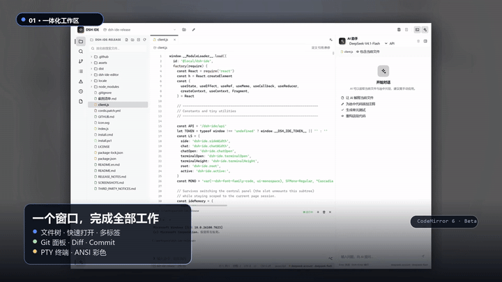
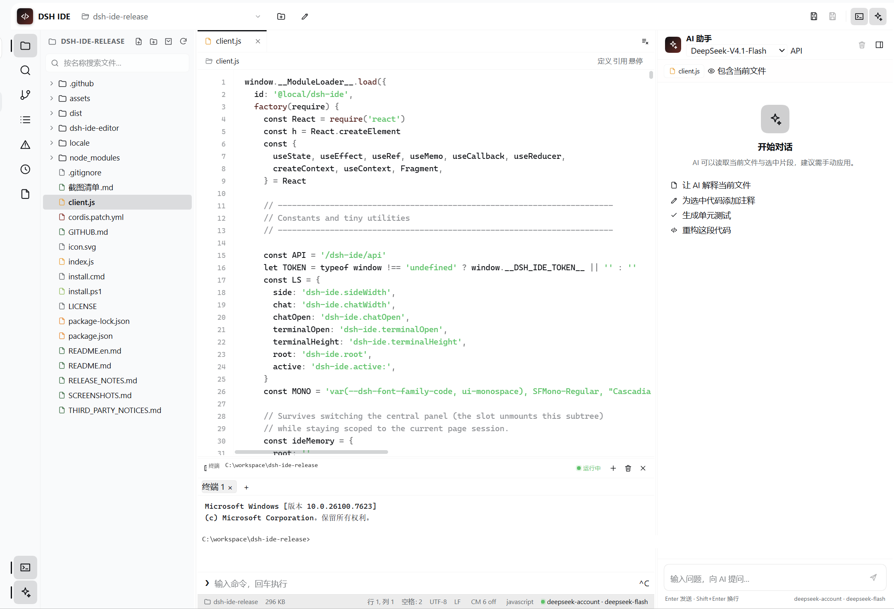
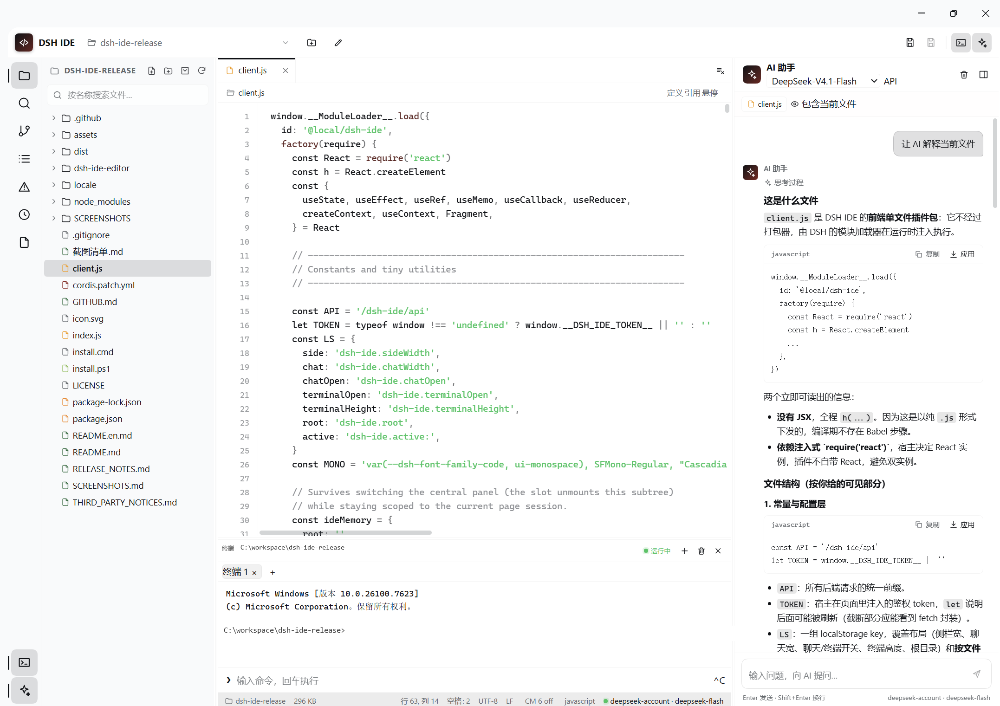

# DSH IDE

[中文](README.md) · [Release Notes](RELEASE_NOTES.md)


A full IDE inside the [DeepSeek Harness](https://github.com/deepseek-ai/deepseek-harness) Web UI.

## Demo



[Download the 25-second 1080p promo](https://github.com/TNTD26/dsh-ide/releases/download/v1.0.0/dsh-ide-promo.mp4) · [Cover](docs/promo/dsh-ide-cover.png) · [Overview still](docs/promo/dsh-ide-still-overview.png) · [AI still](docs/promo/dsh-ide-still-ai.png)

## Features

- Dedicated sidebar entry
- File tree, quick open, search/replace, multi-tab editing
- Syntax highlighting, bracket auto-close/matching, active line, document completion
- Outline, Problems diagnostics, checkpoint history
- AI assistant: model picker, API-key setup, single-file diff preview, multi-file `dsh-patch`
- Git panel: init / status / stage / unstage / commit / diff
- Terminal: tabs, ANSI colors, real PTY
- LSP: definition, references, hover, completion, diagnostics for Python / TypeScript / JavaScript
- Optional CodeMirror 6 Beta: multiple cursors, folding, semantic completion, diagnostic gutter

## Requirements

- DeepSeek Harness **0.2.1-rc.5**
- Node.js **20+** (24 recommended)
- Windows is the primary tested platform
- Pyright and typescript-language-server are installed as package dependencies

## Install

### Release ZIP (recommended)

1. Download the latest ZIP from [Releases](https://github.com/TNTD26/dsh-ide/releases/latest).
2. Extract it anywhere.
3. Run `install.cmd` (or `powershell -NoProfile -ExecutionPolicy Bypass -File .\install.ps1`).
4. In DSH Desktop, open plugin management and install the extracted **root folder**.
5. Restart DSH or refresh the Web UI.

### DSH CLI from GitHub

```powershell
dsh plugin --profile <profile> add github:TNTD26/dsh-ide
```

## Usage

- **AI model**: use the model dropdown under the AI header. `API` stores a provider key in DSH credentials.
- **CodeMirror Beta**: click `CM 6 off` in the status bar to switch. Click it again to fall back.
- **Terminal**: `Ctrl + backtick`; `+` creates a tab, `×` closes it.
- **Git**: branch icon on the left.
- **LSP**: use Definition / References / Hover in the breadcrumb, or `Ctrl+Click`.

## Screenshots





## Development

```powershell
npm install --ignore-scripts
npm --prefix dsh-ide-editor install --ignore-scripts
npm --prefix dsh-ide-editor run build
npm --prefix dsh-ide-editor test
```

## Limitations

- Python diagnostics analyze the file on disk, so unsaved edits may lag.
- CodeMirror is still a Beta and not the default editor.
- Full-screen TUI apps (vim/htop) are not supported yet.
- Multi-file AI patches replace whole files, not individual diff hunks.

## Contributing

See [CONTRIBUTING.md](CONTRIBUTING.md). For security issues, see
[SECURITY.md](SECURITY.md).

## License

MIT. See [LICENSE](LICENSE) and [THIRD_PARTY_NOTICES.md](THIRD_PARTY_NOTICES.md).
