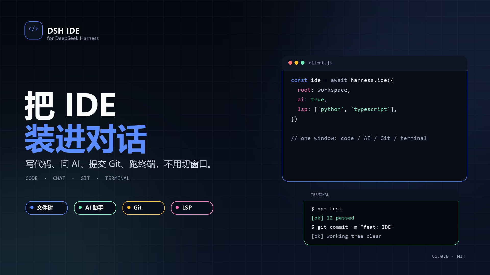
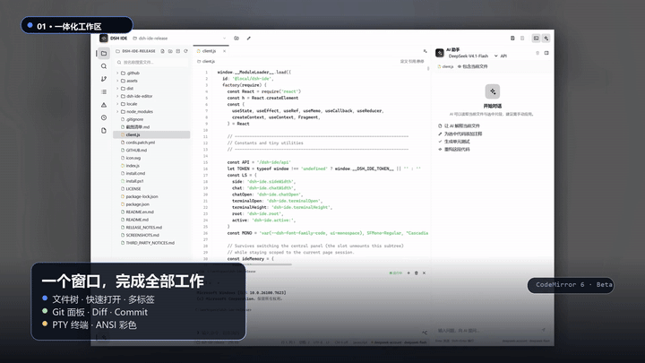
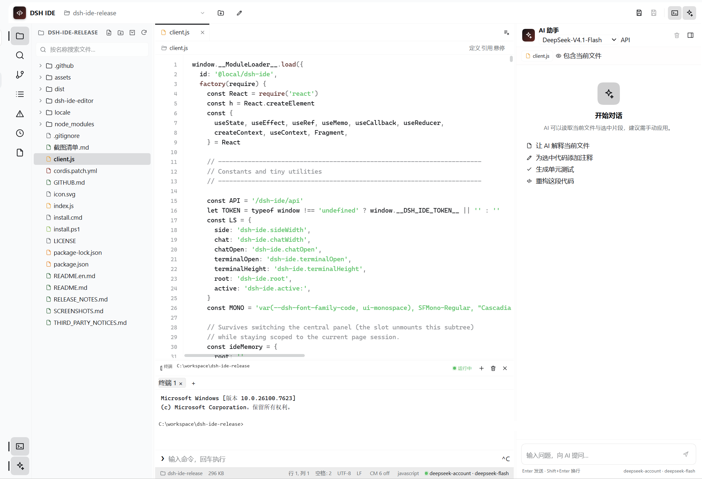
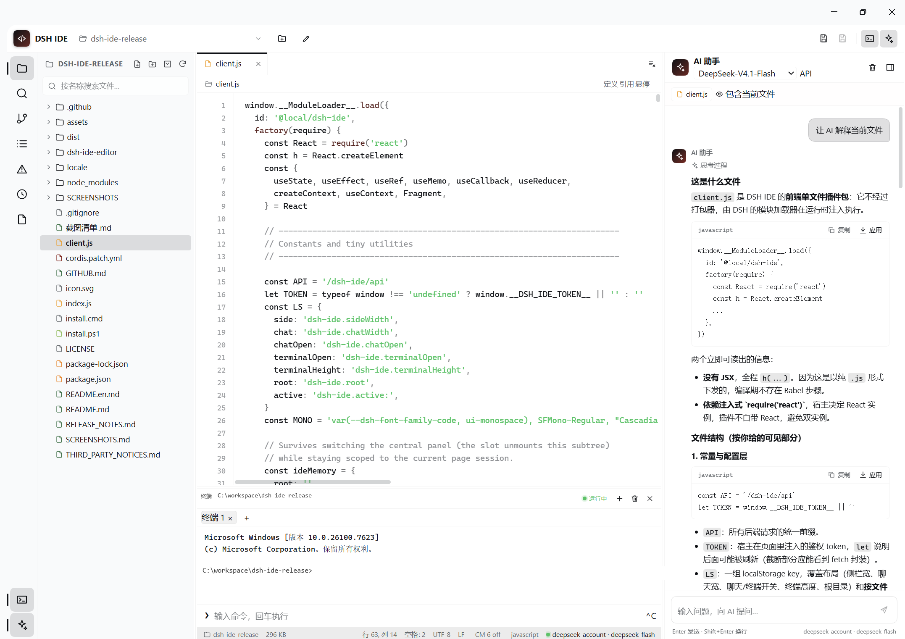

# DSH IDE



[中文](#中文) · [English](#english) · [Release Notes](docs/RELEASE_NOTES.md)


<a id="zh"></a>

## 中文

一个内置在 [DeepSeek Harness](https://github.com/deepseek-ai/deepseek-harness) Web 界面里的完整 IDE 插件。

### 演示



[下载 25 秒 1080p 宣传片](https://github.com/TNTD26/dsh-ide/releases/download/v1.0.0/dsh-ide-promo.mp4) · [总览静帧](docs/promo/dsh-ide-still-overview.png) · [AI 静帧](docs/promo/dsh-ide-still-ai.png)

### 功能

- 侧边栏独立 IDE 入口
- 文件树、快速打开、搜索/替换、文件多标签
- 语法高亮、自动括号、括号匹配、当前行高亮、文档补全
- 大纲、Problems 诊断、检查点历史
- AI 助手：模型选择、API Key 配置、单文件 diff、多文件 `dsh-patch` 补丁
- Git 面板：init / status / stage / unstage / commit / diff
- 终端：多标签、ANSI 颜色、真实 PTY
- LSP：定义、引用、悬停、补全、诊断（Python / TypeScript / JavaScript）
- 可选 CodeMirror 6 编辑器 Beta：多光标、折叠、语义补全、诊断 Gutter

### 环境要求

- DeepSeek Harness **0.2.1-rc.5**
- Node.js **20+**（推荐 24）
- Windows 是当前主要验证平台
- Python / TypeScript 语言服务随包自动安装：Pyright、typescript-language-server

### 安装

> 如果安装过旧版双包（`@local/dsh-ide` + `@local/dsh-ide-lsp`），请先在 DSH 插件管理里卸载它们，再安装本单包。两个版本使用同一个 IDE 路由，不能同时启用。

#### 方式 1：下载 Release ZIP（推荐）

1. 打开 [Releases](https://github.com/TNTD26/dsh-ide/releases/latest)，下载最新 ZIP；
2. 解压到任意目录；
3. 双击 `install.cmd`（或执行 `powershell -NoProfile -ExecutionPolicy Bypass -File .\install.ps1`）；
4. 打开 DSH 桌面端 → 插件管理 → 从本地安装，选择**解压后的根目录**（只安装这一个目录）；
5. 重启 DSH，或刷新 Web 页面。

#### 方式 2：DSH CLI 从 GitHub 安装

```powershell
dsh plugin --profile <你的profile> add github:TNTD26/dsh-ide
```

> 需要本机可访问 GitHub，并让 DSH 安装 npm 依赖。安装完成后同样需要重启 DSH。

### 使用

- **AI 模型**：AI 助手标题下方的下拉框选择 Provider / Model；旁边的 `API` 可保存 API Key（写入 DSH 凭证服务，不保存在浏览器）。
- **CodeMirror Beta**：状态栏的 `CM 6 off` 点击切换。出现问题时点回 `CM 6 off`。
- **终端**：`Ctrl + 反引号` 打开；`+` 新建标签，`×` 关闭。
- **Git**：左侧分支图标。
- **LSP**：Python/TS/JS 文件的面包屑右侧有“定义 / 引用 / 悬停”，也支持 `Ctrl+Click`。

### 开发

```powershell
# 根包依赖（IDE + LSP）
npm install --ignore-scripts

# CodeMirror 构建依赖
npm --prefix dsh-ide-editor install --ignore-scripts

# 重新生成 assets/codemirror.js
npm --prefix dsh-ide-editor run build

# CodeMirror 集成测试
npm --prefix dsh-ide-editor test
```

发版步骤见 [docs/GITHUB.md](docs/GITHUB.md)。

### 目录结构

```text
index.js                   # Host：文件、Git、终端、AI、LSP 桥
client.js                  # IDE Web 客户端
assets/codemirror.js       # 构建后的 CodeMirror 6
cordis.patch.yml           # DSH bundle patch
dsh-ide-editor/            # CodeMirror 构建工程和测试
install.cmd / install.ps1  # 安装根包依赖
screenshots.json           # 市场截图索引
docs/                      # 截图、宣传素材、发版说明
.github/                   # CI、Issue 模板、贡献与安全说明
```

### 截图





截图放在 `docs/screenshots/`，清单见 [docs/SCREENSHOTS.md](docs/SCREENSHOTS.md) 或 [docs/截图清单.md](docs/截图清单.md)。

### 已知限制

- LSP 的补全/诊断走 IDE 自己的桥；Python 诊断基于磁盘文件，未保存修改可能滞后。
- CodeMirror 仍是 Beta，默认未切换；浅色主题适配不完整。
- 完整 TUI（vim/htop）暂不支持，终端是 ANSI 彩色行输入模式。
- AI 多文件补丁使用整文件替换，不是 diff hunk 合并。

### 参与贡献

见 [.github/CONTRIBUTING.md](.github/CONTRIBUTING.md)。安全问题见 [.github/SECURITY.md](.github/SECURITY.md)。

### License

MIT。见 [LICENSE](LICENSE)。第三方组件许可见 [docs/THIRD_PARTY_NOTICES.md](docs/THIRD_PARTY_NOTICES.md)。

<a id="en"></a>

## English

A full IDE inside the [DeepSeek Harness](https://github.com/deepseek-ai/deepseek-harness) Web UI.

### Demo


[Download the 25-second 1080p promo](https://github.com/TNTD26/dsh-ide/releases/download/v1.0.0/dsh-ide-promo.mp4) · [Overview still](docs/promo/dsh-ide-still-overview.png) · [AI still](docs/promo/dsh-ide-still-ai.png)

### Features

- Dedicated sidebar entry
- File tree, quick open, search/replace, multi-tab editing
- Syntax highlighting, bracket auto-close/matching, active line, document completion
- Outline, Problems diagnostics, checkpoint history
- AI assistant: model picker, API-key setup, single-file diff preview, multi-file `dsh-patch`
- Git panel: init / status / stage / unstage / commit / diff
- Terminal: tabs, ANSI colors, real PTY
- LSP: definition, references, hover, completion, diagnostics for Python / TypeScript / JavaScript
- Optional CodeMirror 6 Beta: multiple cursors, folding, semantic completion, diagnostic gutter

### Requirements

- DeepSeek Harness **0.2.1-rc.5**
- Node.js **20+** (24 recommended)
- Windows is the primary tested platform
- Pyright and typescript-language-server are installed as package dependencies

### Install

> If the old two-package version (`@local/dsh-ide` + `@local/dsh-ide-lsp`) is installed, uninstall both before installing this single package. Both versions use the same IDE route and cannot be enabled together.

#### Release ZIP (recommended)

1. Download the latest ZIP from [Releases](https://github.com/TNTD26/dsh-ide/releases/latest).
2. Extract it anywhere.
3. Run `install.cmd` (or `powershell -NoProfile -ExecutionPolicy Bypass -File .\install.ps1`).
4. In DSH Desktop, open plugin management and install the extracted **root folder**.
5. Restart DSH or refresh the Web UI.

#### DSH CLI from GitHub

```powershell
dsh plugin --profile <profile> add github:TNTD26/dsh-ide
```

### Usage

- **AI model**: use the model dropdown under the AI header. `API` stores a provider key in DSH credentials.
- **CodeMirror Beta**: click `CM 6 off` in the status bar to switch. Click it again to fall back.
- **Terminal**: `Ctrl + backtick`; `+` creates a tab, `×` closes it.
- **Git**: branch icon on the left.
- **LSP**: use Definition / References / Hover in the breadcrumb, or `Ctrl+Click`.

### Development

```powershell
npm install --ignore-scripts
npm --prefix dsh-ide-editor install --ignore-scripts
npm --prefix dsh-ide-editor run build
npm --prefix dsh-ide-editor test
```

Release steps: [docs/GITHUB.md](docs/GITHUB.md).

### Layout

```text
index.js                   # Host bridge: files, Git, terminal, AI, LSP
client.js                  # IDE web client
assets/codemirror.js       # built CodeMirror 6 bundle
cordis.patch.yml           # DSH bundle patch
dsh-ide-editor/            # CodeMirror build project and tests
install.cmd / install.ps1  # install root dependencies
screenshots.json           # marketplace screenshot index
docs/                      # screenshots, promo assets, release docs
.github/                   # CI, issue templates, contribution and security
```

### Screenshots


Screenshots live in `docs/screenshots/`; see [docs/SCREENSHOTS.md](docs/SCREENSHOTS.md) for the checklist.

### Limitations

- Python diagnostics analyze the file on disk, so unsaved edits may lag.
- CodeMirror is still a Beta and not the default editor.
- Full-screen TUI apps (vim/htop) are not supported yet.
- Multi-file AI patches replace whole files, not individual diff hunks.

### Contributing

See [.github/CONTRIBUTING.md](.github/CONTRIBUTING.md). For security issues, see
[.github/SECURITY.md](.github/SECURITY.md).

### License

MIT. See [LICENSE](LICENSE) and [docs/THIRD_PARTY_NOTICES.md](docs/THIRD_PARTY_NOTICES.md).

[回到中文](#中文)
